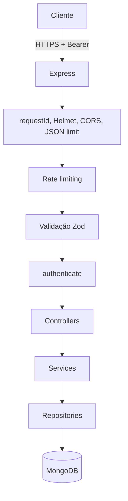
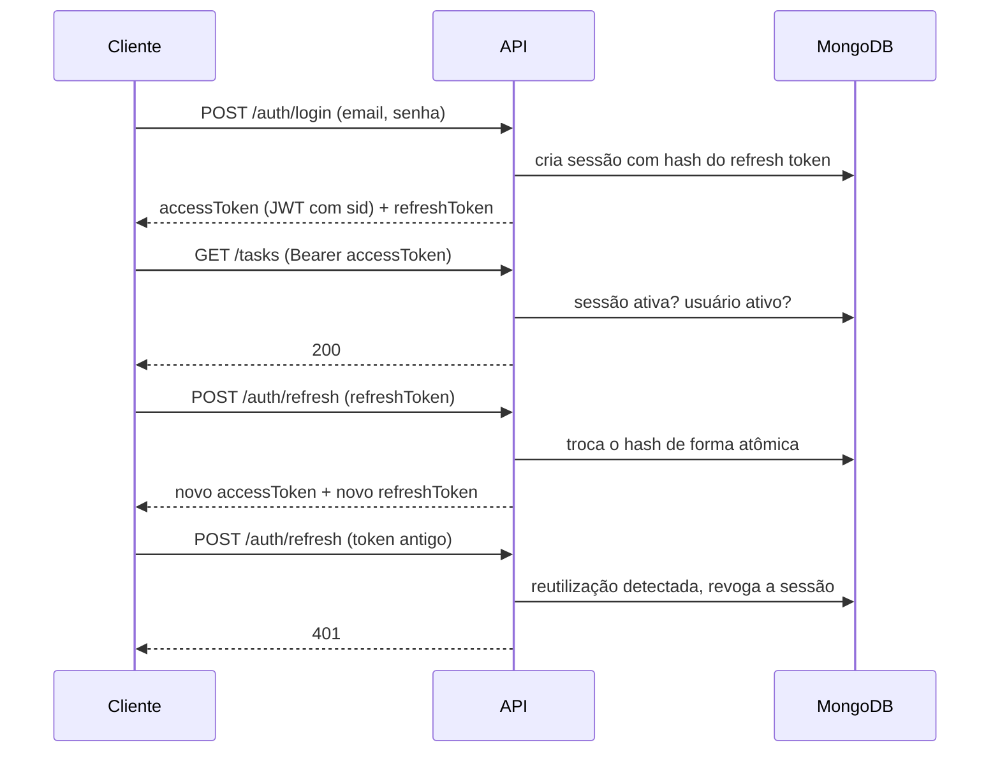

# Task Management API

API REST para gerenciamento de tarefas com autenticação JWT, sessões controladas no backend, documentação OpenAPI e testes automatizados. Projeto de portfólio construído com foco em segurança demonstrável e reprodutibilidade.

- **Prefixo da API:** `/api/v1`
- **Documentação interativa:** `http://localhost:3000/api/docs` (Swagger UI)
- **Especificação OpenAPI:** `http://localhost:3000/api/docs.json`
- **Arquitetura completa:** [ARCHITECTURE.md](ARCHITECTURE.md)

## Funcionalidades

- Cadastro e login com senhas em Argon2id.
- Access token JWT de curta duração e refresh token opaco **rotativo**, com detecção de reutilização.
- Sessões persistidas no MongoDB: logout, logout em todos os dispositivos, listagem e revogação de sessões.
- CRUD de tarefas isolado por usuário, com filtros, busca, ordenação e paginação.
- Validação estrita de entrada com Zod (campos desconhecidos são rejeitados).
- Respostas e erros em formato padronizado, com `requestId` para rastreio.
- Rate limiting, Helmet, CORS restrito, limite de payload e logs estruturados sem segredos.
- Testes unitários, de integração, de segurança e de contrato (respostas reais validadas contra o OpenAPI).

## Stack

| Área                | Tecnologia                                    |
| ------------------- | --------------------------------------------- |
| Runtime / linguagem | Node.js 24, TypeScript (strict)               |
| HTTP                | Express 5                                     |
| Banco / ODM         | MongoDB 8 / Mongoose 9                        |
| Validação           | Zod 4                                         |
| Senhas / tokens     | Argon2id (`argon2`), JWT HS256 (`jose`)       |
| Documentação        | OpenAPI 3.1, Swagger UI, Redocly CLI          |
| Testes              | Vitest, Supertest, mongodb-memory-server, AJV |
| Segurança HTTP      | Helmet, CORS, express-rate-limit              |
| Logs                | Pino                                          |
| Qualidade / CI      | ESLint, Prettier, GitHub Actions              |
| Containers          | Docker multi-stage, Docker Compose            |

## Arquitetura

Monólito modular organizado por domínio (`auth`, `users`, `sessions`, `tasks`). Cada módulo separa rotas, validação, controller, service e repository.



### Fluxo de sessão



## Como rodar

### Pré-requisitos

- Node.js 22 ou superior (24 recomendado) com Corepack habilitado (`corepack enable`)
- pnpm (a versão é fixada em `package.json`)
- Docker (para o MongoDB local ou para o ambiente completo)

### Opção 1: Docker Compose (API + MongoDB)

```bash
cp .env.example .env          # ajuste os segredos
docker compose up -d --build
curl http://localhost:3000/ready
```

O MongoDB fica acessível apenas pela rede interna do Compose. Para parar: `docker compose down` (os dados ficam no volume `mongo-data`). Para apagar tudo, inclusive os dados: `docker compose down -v`.

> **Rede corporativa com inspeção TLS:** se o build falhar com `SELF_SIGNED_CERT_IN_CHAIN`, forneça o bundle de CA da empresa como secret:
> `docker build --secret id=ca,src=/caminho/ca-bundle.pem -t task-management-api:local .` e depois `docker compose up -d --no-build`.

### Opção 2: desenvolvimento local

```bash
pnpm install
cp .env.example .env
docker run -d --name tm-mongo -p 127.0.0.1:27017:27017 mongo:8
pnpm dev
```

Gere segredos fortes e distintos para `JWT_ACCESS_SECRET` e `REFRESH_TOKEN_SECRET`, por exemplo:

```bash
node -e "console.log(require('node:crypto').randomBytes(48).toString('base64url'))"
```

### Scripts

| Comando                             | Descrição                                                    |
| ----------------------------------- | ------------------------------------------------------------ |
| `pnpm dev`                          | Servidor com recarregamento automático                       |
| `pnpm build` / `pnpm start`         | Compila para `dist/` e executa a versão compilada            |
| `pnpm test`                         | Todos os testes (sobe um MongoDB em memória automaticamente) |
| `pnpm lint` / `pnpm typecheck`      | ESLint e verificação de tipos                                |
| `pnpm format` / `pnpm format:check` | Prettier                                                     |
| `pnpm openapi:lint`                 | Valida `src/docs/openapi.yaml` com Redocly                   |

## Variáveis de ambiente

Todas são validadas na inicialização; o processo encerra com uma mensagem clara se algo estiver ausente ou inválido. Veja [.env.example](.env.example).

| Variável                      | Padrão        | Descrição                                                          |
| ----------------------------- | ------------- | ------------------------------------------------------------------ |
| `NODE_ENV`                    | `development` | `development`, `test` ou `production`                              |
| `PORT`                        | `3000`        | Porta HTTP                                                         |
| `API_PREFIX`                  | `/api/v1`     | Prefixo das rotas de negócio                                       |
| `MONGODB_URI`                 | obrigatória   | URI de conexão do MongoDB                                          |
| `JWT_ACCESS_SECRET`           | obrigatória   | Segredo do JWT (32 caracteres ou mais)                             |
| `REFRESH_TOKEN_SECRET`        | obrigatória   | Segredo do HMAC dos refresh tokens; deve ser diferente do anterior |
| `JWT_ISSUER` / `JWT_AUDIENCE` | obrigatórias  | Claims `iss` e `aud` esperadas                                     |
| `ACCESS_TOKEN_TTL`            | `15m`         | Validade do access token (`<n><s\|m\|h\|d>`)                       |
| `REFRESH_TOKEN_TTL_DAYS`      | `30`          | Validade absoluta da sessão                                        |
| `CORS_ORIGINS`                | vazio         | Origens permitidas, separadas por vírgula                          |
| `LOG_LEVEL`                   | `info`        | Nível do Pino                                                      |
| `JSON_BODY_LIMIT`             | `100kb`       | Tamanho máximo do body                                             |
| `REQUEST_TIMEOUT_MS`          | `10000`       | Timeout de requisição do servidor HTTP                             |
| `TRUST_PROXY`                 | `false`       | Habilite atrás de proxy reverso para o IP correto no rate limit    |
| `RATE_LIMIT_WINDOW_MS`        | `900000`      | Janela do rate limit                                               |
| `RATE_LIMIT_AUTH_MAX`         | `10`          | Requisições por janela em cadastro, login e refresh                |
| `RATE_LIMIT_GLOBAL_MAX`       | `300`         | Requisições por janela no restante da API                          |

## Exemplos com cURL

```bash
API=http://localhost:3000/api/v1

# Cadastro
curl -s -X POST $API/auth/register -H 'Content-Type: application/json' \
  -d '{"name":"Maria","email":"maria@example.com","password":"uma-senha-longa"}'

# Login (guarde accessToken e refreshToken)
curl -s -X POST $API/auth/login -H 'Content-Type: application/json' \
  -d '{"email":"maria@example.com","password":"uma-senha-longa","deviceName":"Notebook"}'

ACCESS=<accessToken>
REFRESH=<refreshToken>

# Criar tarefa
curl -s -X POST $API/tasks -H "Authorization: Bearer $ACCESS" -H 'Content-Type: application/json' \
  -d '{"title":"Documentar a API","priority":"high","dueDate":"2026-10-25T18:00:00.000Z","tags":["backend"]}'

# Listar com filtros
curl -s "$API/tasks?status=pending&sortBy=dueDate&order=asc&limit=10" -H "Authorization: Bearer $ACCESS"

# Concluir tarefa
curl -s -X PATCH $API/tasks/<taskId> -H "Authorization: Bearer $ACCESS" -H 'Content-Type: application/json' \
  -d '{"status":"completed"}'

# Renovar tokens (o refresh token anterior deixa de valer)
curl -s -X POST $API/auth/refresh -H 'Content-Type: application/json' -d "{\"refreshToken\":\"$REFRESH\"}"

# Sessões ativas e logout global
curl -s $API/sessions -H "Authorization: Bearer $ACCESS"
curl -s -X POST $API/auth/logout-all -H "Authorization: Bearer $ACCESS"
```

## Decisões e trade-offs

| Decisão                                                            | Motivo                                                                              | Custo aceito                                                                            |
| ------------------------------------------------------------------ | ----------------------------------------------------------------------------------- | --------------------------------------------------------------------------------------- |
| Sessão consultada a cada requisição autenticada                    | Revogação imediata (logout, logout global, conta desativada)                        | Uma leitura extra no banco por requisição                                               |
| Refresh token opaco `<sessionId>.<aleatório>` com hash HMAC-SHA256 | Alta entropia dispensa hash lento; o ID permite localizar a sessão sem varredura    | Quem conhece o ID e forja um token inválido revoga a sessão (o ID só é exposto ao dono) |
| Rotação por `findOneAndUpdate` condicionado ao hash atual          | Atômico em um documento, sem precisar de transação nem replica set                  | Refresh concorrente com o mesmo token: só um vence                                      |
| Refresh token no body JSON, sem cookie                             | Simples para qualquer cliente e sem necessidade de CSRF                             | Navegadores devem manter o token em memória                                             |
| Cada sessão é sua própria família de tokens                        | Reutilização revoga exatamente o dispositivo afetado                                | Não revoga outras sessões do usuário automaticamente                                    |
| Validade absoluta da sessão (sem renovar a expiração no refresh)   | Limita a janela de um token roubado                                                 | Usuário faz login de novo após `REFRESH_TOKEN_TTL_DAYS`                                 |
| `400` para schema inválido; `404` para recurso de outro usuário    | Contrato simples; não revela a existência de recursos alheios                       | `422` fica reservado para regras de negócio futuras                                     |
| Status alterado pelo próprio `PATCH /tasks/:taskId`                | Evita duplicar operações; regras de `completedAt` testadas                          | Não há endpoint dedicado de transição                                                   |
| Prioridade armazenada também como número (`priorityRank`)          | Ordenação semântica low < medium < high no banco                                    | Campo derivado mantido por hook do Mongoose                                             |
| Cadastro com `role` no body é rejeitado (`400`)                    | Validação estrita: campo não permitido falha em vez de ser ignorado silenciosamente | Clientes precisam enviar apenas os campos documentados                                  |

## Testes

`pnpm test` sobe um MongoDB em memória e dá a cada arquivo de teste um banco isolado. Os testes cobrem:

- Regras de negócio (transições de status, `completedAt`).
- Cadastro, login, JWT expirado, adulterado, com `alg: none` ou com `iss`/`aud` errados.
- Sessão revogada ou expirada, usuário desativado, rotação e reutilização de refresh token, concorrência.
- Logout idempotente, logout global, listagem e revogação de sessões.
- Isolamento entre usuários (BOLA) em leitura, edição, exclusão e listagem; mass assignment.
- Filtros, paginação, injeção de operadores e caracteres de regex na busca.
- Rate limit, CORS, headers de segurança, limite de payload e erro 500 sem vazamento.
- Contrato: respostas reais validadas contra o OpenAPI (`additionalProperties: false` detecta campos vazados) e verificação de quais rotas exigem autenticação.

## Limitações conhecidas e roadmap

- Rate limit em memória: com várias instâncias, use um store compartilhado (Redis).
- Sem painel administrativo; o papel `admin` existe no modelo, mas ainda não há rotas que o usem.
- Busca por regex (adequada ao volume de um usuário); um índice de texto seria melhor para grandes volumes.
- Fora do escopo desta versão: equipes e compartilhamento, comentários, anexos, notificações, tarefas recorrentes e auditoria detalhada.

## Contribuição, segurança e licença

- [CONTRIBUTING.md](CONTRIBUTING.md)
- [SECURITY.md](SECURITY.md)
- Licença [MIT](LICENSE)
